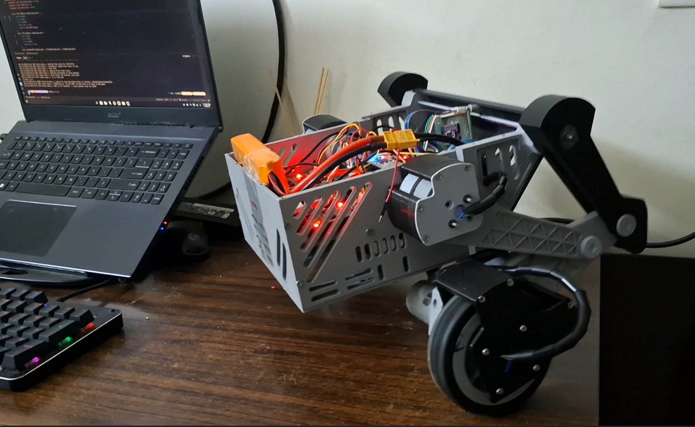
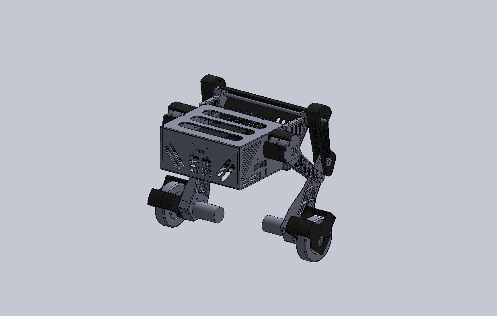

# BipedalV1 Firmware

Firmware for a two-wheeled balancing robot built on the STM32F411CEU6 microcontroller.





> Note:
> The robot balances on its wheels across a flat table surface. Hip actuators do not work in the current firmware and will be worked on in later revisions. 3D print files for mechanical parts and gearbox components are in the CAD/STL folder.

## System Hardware

- Controller: STM32F411CEU6 with ARM Cortex-M4F core clocked at 96 MHz
- Flash and RAM: 512 KB flash memory and 128 KB SRAM
- Inertial Sensor: MPU6050 six-axis gyroscope and accelerometer
- Wheel Encoders: Dual MT6701 magnetic encoders
- Hip Encoders: Dual AS5600 magnetic encoders
- Current and Power Monitors: Dual INA219 current sensors
- Actuators: Two DC wheel motors and two DC hip motors

## Control Design

The robot balances using a cascaded dual-loop controller. Only wheel balancing is active right now, while the hip actuators haven't been programmed yet.

The inner balancing loop runs at 200 Hz. It reads pitch and pitch rate from the MPU6050. A complementary filter blends accelerometer tilt measurements with gyroscope rates. The inner loop feeds corrective effort straight to the wheel motors.

The outer speed loop runs at 150 Hz. It reads average wheel speed in RPM from the magnetic encoders, computes speed error against the target speed, and outputs a target pitch offset to the inner loop. When the body tilts beyond 20 degrees, the controller disables motor outputs to prevent runaways.

Wheel motors run under locked anti-phase control at 32 kHz on Timer 5. In this mode, a 50 percent PWM duty cycle holds the motor stationary. Values above 50 percent drive the motor forward, while values below 50 percent drive it backward. This avoids separate direction pins on the wheel drives.

Hip motors are mapped to sign magnitude control with independent direction pins, but they are not driven in the active control loop.

A dedicated background task reads the battery voltage divider on ADC channel 4. When a 3S battery drops below 10 percent charge, the buzzer sounds an alert sequence.

## Pin Connections

### Motors and Actuators

- PA0: Left hip PWM, Timer 5 Channel 1
- PA1: Left wheel locked anti-phase PWM, Timer 5 Channel 2
- PA2: Right wheel locked anti-phase PWM, Timer 5 Channel 3
- PA3: Right hip PWM, Timer 5 Channel 4
- PA5: Left hip direction output
- PA6: Right hip direction output
- PA7: Wheel motor driver enable output

### I2C Buses and Sensors

- PB6: I2C1 SCL, PCA9548A encoder multiplexer
- PB7: I2C1 SDA, PCA9548A encoder multiplexer
- PB10: I2C2 SCL, MPU6050 sensor
- PB9: I2C2 SDA, MPU6050 sensor
- PB4: EXTI line 4, MPU6050 data ready interrupt
- PA8: I2C3 SCL, INA219 current sensors
- PB8: I2C3 SDA, INA219 current sensors

### Multiplexer Channels

- Channel 0: Right hip AS5600 encoder
- Channel 1: Left hip AS5600 encoder
- Channel 2: Left wheel MT6701 encoder
- Channel 5: Right wheel MT6701 encoder, inverted count direction

### Current Sensor Addresses

- Address 0x40: Left hip INA219
- Address 0x41: Right hip INA219

### System Utilities

- PA4: ADC1 channel 4, battery voltage monitor
- PB0: Timer 3 Channel 3 PWM, buzzer alert
- PB1: Digital output, cooling fan
- PC13: Onboard LED, active low indicator

## Repository Layout

```text
BipedalV1/
├── Assembly.JPG
├── Bipedal.png
├── CMakeLists.txt
├── linker.ld
├── startup.cpp
├── mcuviewer.cfg
├── readme.md
├── CAD/
│   └── STL/
├── include/
│   ├── BalancePID.h
│   ├── BatteryManager.h
│   ├── Buzzer.h
│   ├── Context.h
│   ├── EncoderI2CMux.h
│   ├── FanController.h
│   ├── INA219.h
│   ├── PIDController.h
│   ├── ServoManager.h
│   └── drivers/
│       ├── ADC.h
│       ├── Clock.h
│       ├── GPIO.h
│       ├── I2C.h
│       ├── Interrupt.h
│       ├── MPU6050.h
│       ├── MemoryMap.h
│       ├── PWM.h
│       └── Peripherals.h
└── src/
    ├── BalancePID.cpp
    ├── Buzzer.cpp
    ├── Context.cpp
    ├── EncoderI2CMux.cpp
    ├── FanController.cpp
    ├── INA219.cpp
    ├── PIDController.cpp
    ├── ServoManager.cpp
    ├── main.cpp
    └── drivers/
        └── Clock.cpp
```

## Building and Flashing

### Prerequisites

- Toolchain: `arm-none-eabi-gcc`
- Build Tools: CMake and Ninja
- Flash Utilities: `dfu-util` or `stlink-tools`

Ubuntu or Debian:

```bash
sudo apt install gcc-arm-none-eabi cmake ninja-build dfu-util stlink-tools
```

Arch Linux:

```bash
sudo pacman -S arm-none-eabi-gcc arm-none-eabi-newlib cmake ninja dfu-util stlink
```

### Compile the Project

```bash
cmake -B cmake-build-debug -G Ninja
cmake --build cmake-build-debug
```

### Flash via DFU

Put the board into DFU mode by holding BOOT0 while resetting the chip.

```bash
dfu-util -a 0 -d 0483:df11 -s 0x08000000:leave -D cmake-build-debug/BipedalV1.bin
```

### Flash via ST-Link

Connect an ST-Link probe to SWCLK, SWDIO, GND, and 3.3V.

```bash
st-flash write cmake-build-debug/BipedalV1.bin 0x08000000
st-flash reset
```

## Datasheets and Manuals

Technical references included in the repository:

- STM32F411 Reference Manual: ReferenceManual.pdf
- STM32F411 Programming Manual: programming manual.pdf
- STM32F411 Datasheet: DataSheet.pdf
- GPIO Alternate Function Table: Alternate Function Table.pdf
